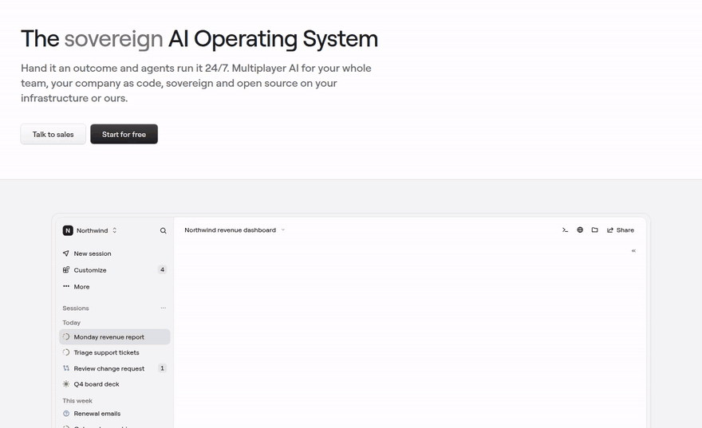

<div align="center">

<picture>
  <source media="(prefers-color-scheme: dark)" srcset="apps/web/public/brandkit/Logo/Logomark/SVG/Logomark%20White.svg">
  
</picture>

# Kortix CompanyOS

**The open-source CompanyOS: the cloud-native agent harness for companies.**

Open Source &nbsp;·&nbsp; Extensible &nbsp;·&nbsp; Multiplayer &nbsp;·&nbsp; Sovereign

Always-on agents that start on events, run in parallel and share one memory of your company.

Build custom agents on pi and ship them from one git repo. Schedules, webhooks, your tools' events
and your team's messages start them. My Kortix routes the work, and swarms of agents run it in
parallel, each on its own cloud computer with state that persists.

Agents connect to 3,000+ apps, build and host the apps your company needs, and land every change
through a review your team approves. Share agents and context across your whole team.
Open source, any model, on your infrastructure or ours.

[](https://github.com/kortix-ai/CompanyOS/stargazers)
[](https://github.com/kortix-ai/CompanyOS/releases/latest)
[](https://kortix.com/docs/guide)
[](#contributing)

[Website](https://kortix.com) · [Guide](https://kortix.com/docs/guide) · [Cloud](https://kortix.com/auth) · [AI Transformation](https://kortix.com/services) · [Manifesto](MANIFESTO.md)

<br />



</div>

---

## A new kind of system

An agent today is one chat session on one machine. It waits for a person to type. It blocks while a
long job runs. Every task it takes on shares one context. It stops when the laptop sleeps. A person
can follow only a few such sessions at once, so human attention runs out long before the model does.

Kortix CompanyOS takes the session out of the person's hands. It is a **cloud-native agent harness**: you
write custom agents on pi, an open-source agent harness, and Kortix deploys them to the cloud and
supplies everything around the agent loop that one session cannot.

| | |
| --- | --- |
| **Always on** | Compute and state are separate. Every session runs on its own cloud computer. The computer sleeps 15 to 20 minutes after the last turn and wakes on the next message or event, with its full history. State lives in the repo, in Drive, in the session's `/workspace` and in the session's record. |
| **Event-driven** | Triggers start agents from schedules, signed webhooks, connector events, App events and merged change requests. A filter in code drops noise before any model runs. A session subscribes to the events of its own work, and an agent sets its own check-in before it stops. |
| **One agent to talk to** | You talk to **My Kortix**. It answers at once, hands writing, research, code and app work to the agent made for it in a session of its own, and tells you the result. Nothing it hands off blocks the conversation. A follow-up goes to the same agent, with everything that agent already knows. |
| **Swarms** | A session hands work off in the background, runs a workflow that coordinates many agents, and messages other sessions. Every child reports back by itself. Thousands of agents run in parallel on one config. |
| **Long horizon** | When a context fills, the agent continues in a fresh one and searches the session's full record for the exact lines it needs. Nothing is summarized. A job outlives one turn and one context window. |
| **Scales out** | Compute is disposable and state persists, so capacity grows by adding computers, not by growing one. Each new session gets its own computer. A sleeping computer uses no compute. |

```
  You, in the web app             Slack · Teams · email        Events
        │                         threads                      schedules · webhooks
        ▼                              │                       app + connector events
 ┌─────────────┐                       │                       change requests · loops
 │  My Kortix  │ answers at once,      │                              │
 │             │ never blocks          │                       ┌──────┴──────┐
 └──────┬──────┘                       │                       │  Triggers   │ filter in code,
        │ hands off in the background  │                       └──────┬──────┘ then start or wake
        ▼                              ▼                              ▼
 ┌────────────────────────────────────────────────────────────────────────┐
 │ Agent sessions: custom pi agents, each on its own cloud computer       │
 │ hand-offs · workflows · messages between sessions · reports back       │
 └────────────────────────────────────────────────────────────────────────┘
                                     │
                                     │ sleeps when idle, wakes with its full history
                                     ▼
   State that persists: git repo · Drive · /workspace · session record
   What lands on main goes through a change request a person approves
```

Connect your company's tools once, and every agent and every teammate works with them, with the
same skills and the same company memory. Your agents, skills, memory and connectors live in **one
git repo you own**: your whole company as code. Any model, your own keys, on Kortix Cloud, in your
VPC or on your own on-prem network.

---

## Kortix, end to end

One system, from the message that starts the work to the change that lands it.

| Layer | What it does | Guide |
| --- | --- | --- |
| **Reach** | People work from the web, desktop and mobile apps, the terminal, Slack, Microsoft Teams and email, and from other AI tools through MCP. All of them read the same projects and sessions. | [Everywhere](https://kortix.com/docs/guide#everywhere) |
| **Triggers** | Schedules, signed webhooks, connector events, App events and merged change requests start agents with nobody at the keyboard. A filter in code drops noise first. A loop wakes a session later, once or on repeat. | [Triggers](https://kortix.com/docs/guide#triggers) |
| **My Kortix** | The one agent you talk to. It hands each task to the agent made for it, runs the work in the background and reports the result. | [The built-in agent](https://kortix.com/docs/guide#the-built-in-agent) |
| **Agents** | Custom pi agents: a prompt, a model, permissions, and the skills, tools, commands and pi extensions they may use. An agent proposes changes to its own skills, and a person approves them. | [Agents](https://kortix.com/docs/guide#agents), [Skills](https://kortix.com/docs/guide#skills) |
| **Swarms** | Background hand-offs, workflows that run many agents at once, and messages between sessions. Thousands of agents run in parallel on one config. | [Several agents at once](https://kortix.com/docs/guide#several-agents-at-once) |
| **Outcomes** | A goal with a definition of done. An agent works it, wake after wake, until a separate verifier session confirms it is done. | [Outcomes](https://kortix.com/docs/guide#outcomes) |
| **Computers** | Every session gets its own isolated cloud computer: a terminal, a browser, a desktop you can watch live, the tools its sandbox template installs. It sleeps when idle and wakes with its full history. Connect your own computer for work that must run on it. | [Computers](https://kortix.com/docs/guide#computers) |
| **Memory and state** | The git repo holds the company's agents, skills and rules. Drive holds shared folders and company memory. `/workspace` keeps a session's files. When a context fills, the agent searches the session's full record word for word. | [Drive](https://kortix.com/docs/guide#drive) |
| **Connectors** | 3,000+ apps, plus MCP, OpenAPI, GraphQL and raw HTTP. Allow, Ask or Block per tool. Credentials stay on the server and never enter the machine. | [Connectors](https://kortix.com/docs/guide#connectors) |
| **Apps** | Agents build and host sites, internal tools and backends at a stable URL, behind Kortix sign-in. Always-on or on-demand machines, up to 20 per group, persistent volumes, snapshots, releases and rollback. | [Apps](https://kortix.com/docs/guide#apps) |
| **Models** | Kortix-managed models, your own provider keys, a ChatGPT subscription or a Claude subscription. Every request goes through the Kortix LLM gateway with budgets and access rules. | [Models](https://kortix.com/docs/guide#models) |
| **Team and control** | Roles, groups and per-resource permissions. Change requests a person approves, approval rules, an audit log, SAML 2.0 SSO and SCIM 2.0, secrets encrypted with a key per project. | [Teams](https://kortix.com/docs/guide#teams), [Security](https://kortix.com/docs/guide#security) |
| **Build on it** | The `kortix` CLI, the REST API, `@kortix/sdk`, its React hooks, `@kortix/ui` and generative UI. | [Developers](https://kortix.com/docs/developers) |
| **Run it anywhere** | Kortix Cloud, your VPC or your own on-prem network, from the same images. | [Self-host](https://kortix.com/docs/developers#self-hosting) |

---

## What is a CompanyOS?

An operating system is the layer everything on a computer runs on. A CompanyOS is that layer for
a company: the place its AI agents do the work, and the rules they work under.

| A computer's OS | Kortix CompanyOS |
| --- | --- |
| Shell | **My Kortix**: the one agent you talk to. It routes the work. |
| Programs | **Agents**: custom pi agents, each with a job, a model and a set of permissions |
| Libraries | **Skills**: written playbooks every agent shares |
| File system | **Drive**: shared folders, with company memory as Markdown files |
| Drivers | **Connectors**: 3,000+ apps, plus MCP, OpenAPI and raw HTTP |
| Processes | **Sessions**: each one on its own cloud computer that sleeps when idle |
| Interrupts and scheduler | **Triggers**: schedules, webhooks and app events, 24/7 |
| Users and permissions | **Roles, groups and approvals**: a person approves what reaches `main` |

`kortix.yaml` declares all of it, and every agent, skill and rule is a file in one repo you own.
That is your company as code.

---

## Three things make it yours

| | |
| --- | --- |
| **Multiplayer AI**<br />One AI for the whole team. | Everyone works with the same agents, skills, memory and connectors, from the web app, Slack or Microsoft Teams. Roles, groups and per-resource permissions decide who may do what, and a person approves what reaches `main`. |
| **Company as code**<br />Extensible to the core. | Every agent, skill, rule, connector and piece of context is a file in one git repo: versioned, reviewed and extended like software. The agents and the harness they run on are open source. 3,000+ apps, plus MCP, OpenAPI and raw HTTP. A CLI and a TypeScript SDK. |
| **Sovereign and open**<br />Own your data and your infrastructure. | Open source: read it, fork it, audit it. Self-host in your VPC or on-prem. Any model provider with your own keys. Secrets encrypted at rest with a key per project. |

---

## Give it an outcome. AI agents run it 24/7.

```
Outcome ──> Plan ──> Work ──> Verify ──> Learn ──┐
   ^                                             │
   └──────────── the next run starts there ──────┘
```

1. **Outcome.** You state it once, in plain words, with the rules that matter.
2. **Plan.** An agent owns it end to end, breaks it into work and wakes itself on a schedule.
3. **Work.** Agents run on their own cloud computers at any hour, started by schedules, webhooks and your tools.
4. **Verify.** A separate agent checks the result, and changes land through a change request you approve.
5. **Learn.** What the agents learned goes back into company memory and skills. Every run makes the next one better.

Thousands of agents can run in parallel on one config. [How outcomes work →](https://kortix.com/docs/guide#outcomes)

---

## Quickstart

Three commands. Build your company like a codebase, then bring it live.

```bash
# 1 · Install the CLI
curl -fsSL https://kortix.com/install | bash

# 2 · Scaffold a project: kortix.yaml plus your agents, skills and runtime config
kortix init

# 3 · Ship it: push the repo and bring the whole thing live in the cloud
kortix ship
```

From here:

```bash
kortix sessions new --prompt "Summarize this week's commits and open a change request"
kortix cr ls          # review what an agent proposes, merge to keep it
kortix chat           # talk to a session's agent from your terminal
```

No setup: sign up at **[kortix.com](https://kortix.com)**, create a project and start a session.
The **[Guide](https://kortix.com/docs/guide)** walks you through Kortix CompanyOS from A to Z.

---

## What runs on Kortix CompanyOS

- **SciencePal**, the AI research assistant of the Hong Kong Institute of AI for Science at City University of Hong Kong, built from Kortix's open-source code.
- **Platinum**, a sandbox cloud for AI agents, built and tested by agents on Kortix.
- **Kortix itself**: an intake agent triages every issue and worker agents fix it on their own machines.
- **An AI-run hedge fund desk**, our own, on real public SEC data with simulated capital.
- **A US telecommunications infrastructure company** whose agents design fiber routes, self-hosted in its own cloud.
- **An international executive search firm**, rebuilt around agents.
- **WRITER**, the enterprise AI platform, built from Kortix's open-source code.
- **Wring**, autonomous AWS cost optimization.

[See the case studies →](https://kortix.com/#case-studies)

---

## Self-host

Kortix CompanyOS is self-hosting native: one Docker Compose stack in your cloud account, your VPC or on your
own servers, from the same images the managed cloud runs.

```bash
curl -fsSL https://kortix.com/install | bash
kortix self-host start
kortix hosts use selfhost  # ↔  kortix hosts use cloud
```

The first run asks six things and no model key. You connect GitHub and add model keys in the app
afterwards. Agent sandboxes run on the provider you configure (Platinum by default), and the stack
pulls its images from Docker Hub, so this is a self-hosted install, not a disconnected one.
[Self-hosting guide →](https://kortix.com/docs/host)

---

## Security

One isolated machine per session · per-resource permissions for people and agents · roles, groups
and an audit trail · SAML 2.0 single sign-on and SCIM 2.0 · connector credentials held server-side
· secrets encrypted at rest with a key per project · merge deny-by-default for agents · approval
rules you set · Kortix Cloud, your VPC or on-prem. **SOC 2 Type I verified.**
[Security →](https://kortix.com/security)

---

## AI Transformation, done for you

Don't want to build it yourself? Our team maps your company, unifies your data, automates the work
with agents, builds your custom apps and trains your team, all on Kortix CompanyOS, in a repo you own.
**[kortix.com/services](https://kortix.com/services)**

---

## White-label

Kortix stays open source. A free white-label license lets you run it under your own name and logo,
in your own structure, and as a hosted service for your customers. The one requirement: use
[Platinum](https://www.platinum.dev) as your exclusive compute provider for everything it offers,
at rates we commit to keep competitive. Sign online and you are licensed on the spot:
**[WHITE-LABEL-LICENSE.md](WHITE-LABEL-LICENSE.md)**. Custom terms:
[marko@kortix.ai](mailto:marko@kortix.ai).

---

## Contributing

```bash
pnpm install
pnpm dev            # web + API (scripts/dev-local.sh)
pnpm dev:web        # web app only
pnpm dev:api        # API only
pnpm dev:sandbox    # build the local sandbox image
pnpm build          # build all packages
pnpm nuke           # tear down the local Docker environment
```

Apps live under `apps/` (`web`, `api`, `cli`, `desktop-electron`, `mobile`, `sandbox`). The Guide
and the developer reference are in `apps/web/content/docs`. The whole platform ships under one
version (root `VERSION`): API, frontend, CLI and desktop release together as `vX.Y.Z`.

Local secrets, test lanes and the PR loop: **[CONTRIBUTING.md](CONTRIBUTING.md)**. Issues and pull
requests are welcome.

---

<div align="center">
<br />
<strong>We are building the Operating System for SuperIntelligence: for companies run by AI, owned end to end.</strong>
<br /><br />
<a href="https://kortix.com">kortix.com</a>
</div>
