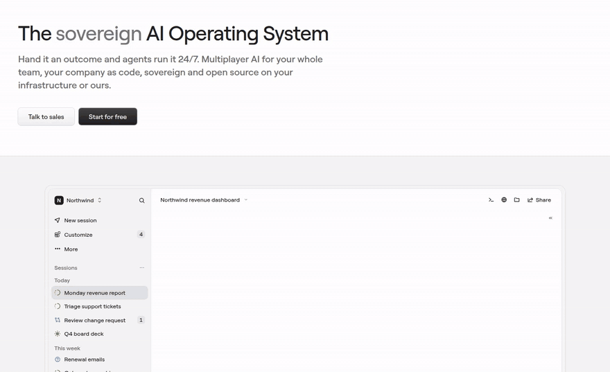

<div align="center">

<picture>
  <source media="(prefers-color-scheme: dark)" srcset="apps/web/public/brandkit/Logo/Brandmark/SVG/Brandmark%20White.svg">
  
</picture>

# Kortix

**The sovereign AI Operating System.**

Multiplayer AI for your whole team. Your company as code. Sovereign and open source.<br />
Hand it an outcome and agents run it 24/7.

[](https://github.com/kortix-ai/suna/stargazers)
[](https://github.com/kortix-ai/suna/releases/latest)
[](https://kortix.com/docs/guide)
[](#contributing)

[Website](https://kortix.com) · [Guide](https://kortix.com/docs/guide) · [Cloud](https://kortix.com/auth) · [AI Transformation](https://kortix.com/services) · [Manifesto](MANIFESTO.md)

<br />



</div>

---

Kortix is the open-source AI Operating System. Your agents, the skills they share, your company
memory and every connector live in **one git repo you own**. Every session runs on **its own cloud
computer**, and work lands through a **change request a person approves**.

Any model, your own keys, on Kortix Cloud, in your VPC or on your own on-prem network.

---

## Three things make it yours

| | |
| --- | --- |
| **Multiplayer AI**<br />One AI for the whole team. | Everyone works with the same agents, skills, memory and connectors, from the web app, Slack or Microsoft Teams. Roles, groups and per-resource permissions decide who may do what, and a person approves what reaches `main`. |
| **Company as code**<br />Extensible to the core. | Every agent, skill, rule, connector and piece of context is a file in one git repo: versioned, reviewed and extended like software. The agents and the harness they run on are open source. 3,000+ apps, plus MCP, OpenAPI and raw HTTP. A CLI and a TypeScript SDK. |
| **Sovereign and open**<br />Own your data and your infrastructure. | Open source: read it, fork it, audit it. Self-host in your VPC or on-prem. Any model provider with your own keys. Secrets encrypted at rest with a key per project. |

---

## Give it an outcome. Agents run it 24/7.

```
Outcome ──> Plan ──> Work ──> Verify ──> Learn ──┐
   ^                                             │
   └──────────── the next run starts there ──────┘
```

1. **Outcome.** You state it once, in plain words, with the rules that matter.
2. **Plan.** An agent owns it end to end, breaks it into work and wakes itself on a schedule.
3. **Work.** Agents run on their own cloud computers at any hour, started by schedules, webhooks and your tools.
4. **Verify.** A separate agent checks the result, and changes land through a change request you approve.
5. **Learn.** What the agents learned goes back into company memory and skills. Every run makes the next one better.

Thousands of agents can run in parallel on one config. [How outcomes work →](https://kortix.com/docs/guide#outcomes)

---

## Quickstart

Three commands. Build your company like a codebase, then bring it live.

```bash
# 1 · Install the CLI
curl -fsSL https://kortix.com/install | bash

# 2 · Scaffold a project: kortix.yaml plus your agents, skills and runtime config
kortix init

# 3 · Ship it: push the repo and bring the whole thing live in the cloud
kortix ship
```

From here:

```bash
kortix sessions new --prompt "Summarize this week's commits and open a change request"
kortix cr ls          # review what an agent proposes, merge to keep it
kortix chat           # talk to a session's agent from your terminal
```

No setup: sign up at **[kortix.com](https://kortix.com)**, create a project and start a session.
The **[Guide](https://kortix.com/docs/guide)** walks you through Kortix from A to Z.

---

## The building blocks

| | | Guide |
| --- | --- | --- |
| **Agents** | Assistants with a job, a model and a set of permissions. An agent can propose changes to its own configuration; a person approves them. | [Agents](https://kortix.com/docs/guide#agents) |
| **Skills** | Written playbooks for how your company does a job, shared by every agent. | [Skills](https://kortix.com/docs/guide#skills) |
| **Drive** | Shared folders for people and agents, including the company's memory as Markdown files. | [Drive](https://kortix.com/docs/guide#drive) |
| **Connectors** | 3,000+ apps, plus MCP, OpenAPI, GraphQL and raw HTTP. Allow, Ask or Block per tool. Credentials stay on the server and never enter the machine. | [Connectors](https://kortix.com/docs/guide#connectors) |
| **Automations** | Schedules, signed webhooks and app events that start agents with nobody at the keyboard. | [Automations](https://kortix.com/docs/guide#automations) |
| **Outcomes** | An agent owns an objective until a separate check confirms it is met. | [Outcomes](https://kortix.com/docs/guide#outcomes) |
| **Computers** | Every session gets its own isolated machine and branch. You can also connect your own computer. | [Computers](https://kortix.com/docs/guide#computers) |
| **Apps** | The compute platform: sites, internal tools and backends with data, functions and realtime, at a stable URL. | [Apps](https://kortix.com/docs/guide#apps) |
| **Channels** | Start and continue work from Slack, Microsoft Teams and email. | [Channels](https://kortix.com/docs/guide#channels) |
| **Models** | Any provider with your own keys, the ChatGPT plan you already pay for, or Kortix-managed models. | [Models](https://kortix.com/docs/guide#models) |

---

## What runs on Kortix

- **SciencePal**, the AI research assistant of the Hong Kong Institute of AI for Science at City University of Hong Kong, built from Kortix's open-source code.
- **Platinum**, a sandbox cloud for AI agents, built and tested by agents on Kortix.
- **Kortix itself**: an intake agent triages every issue and worker agents fix it on their own machines.
- **An AI-run hedge fund desk**, our own, on real public SEC data with simulated capital.
- **A US telecommunications infrastructure company** whose agents design fiber routes, self-hosted in its own cloud.
- **An international executive search firm**, rebuilt around agents.
- **WRITER**, the enterprise AI platform, built from Kortix's open-source code.
- **Wring**, autonomous AWS cost optimization.

[See the case studies →](https://kortix.com/#case-studies)

---

## How it compares

| | Claude Cowork | ChatGPT Work | **Kortix** |
| --- | --- | --- | --- |
| **Source** | Closed | Closed | **Open source: read it, fork it, audit it** |
| **Models** | Anthropic only | OpenAI only | **Any provider, your own API keys** |
| **Where it runs** | Anthropic's cloud or its cloud partners, no self-host | OpenAI's cloud, no self-host | **Our cloud, your VPC, or your own on-prem network** |
| **Your configuration** | In their product | In their product | **Files in a git repo you own** |

Competitor rows reflect publicly documented behavior as of July 2026.

| If you are looking at… | Pick it when | Pick Kortix when |
| --- | --- | --- |
| **n8n** (workflow automation) | The job is a fixed flowchart: the same steps, in the same order, every time. | The job is open-ended work an agent does on its own computer, with the configuration in git and a person approving what it changes. |
| **OpenHands** (coding agents) | You want a coding-agent control center for an engineering team. | Coding is one of many jobs: the same agents also work in Slack, on schedules and across 3,000+ apps. |
| **Paperclip** (agent orchestration) | You already run agents and want an org chart and a task board on top of them. | You want the platform to run the agents too, each session on its own cloud computer, from one repo. |
| **Onyx, Open WebUI, LibreChat** (chat and search) | You want a chat window or search over company documents. | You want agents that return finished work and take real actions in your tools. |

---

## Self-host

Kortix is self-hosting native: one Docker Compose stack in your cloud account, your VPC or on your
own servers, from the same images the managed cloud runs.

```bash
curl -fsSL https://kortix.com/install | bash
kortix self-host start
kortix hosts use selfhost  # ↔  kortix hosts use cloud
```

The first run asks six things and no model key. You connect GitHub and add model keys in the app
afterwards. Agent sandboxes run on the provider you configure (Platinum by default), and the stack
pulls its images from Docker Hub, so this is a self-hosted install, not a disconnected one.
[Self-hosting guide →](https://kortix.com/docs/host)

---

## Security

One isolated machine per session · per-resource permissions for people and agents · roles, groups
and an audit trail · SAML 2.0 single sign-on and SCIM 2.0 · connector credentials held server-side
· secrets encrypted at rest with a key per project · merge deny-by-default for agents · approval
rules you set · Kortix Cloud, your VPC or on-prem. **SOC 2 Type I verified.**
[Security →](https://kortix.com/security)

---

## AI Transformation, done for you

Don't want to build it yourself? Our team maps your company, unifies your data, automates the work
with agents, builds your custom apps and trains your team, all on Kortix, in a repo you own.
**[kortix.com/services](https://kortix.com/services)**

---

## White-label

Kortix stays open source. A free white-label license lets you run it under your own name and logo,
in your own structure, and as a hosted service for your customers. The one requirement: use
[Platinum](https://www.platinum.dev) as your exclusive compute provider for everything it offers,
at rates we commit to keep competitive. Sign online and you are licensed on the spot:
**[WHITE-LABEL-LICENSE.md](WHITE-LABEL-LICENSE.md)**. Custom terms:
[marko@kortix.ai](mailto:marko@kortix.ai).

---

## Contributing

```bash
pnpm install
pnpm dev            # web + API (scripts/dev-local.sh)
pnpm dev:web        # web app only
pnpm dev:api        # API only
pnpm dev:sandbox    # build the local sandbox image
pnpm build          # build all packages
pnpm nuke           # tear down the local Docker environment
```

Apps live under `apps/` (`web`, `api`, `cli`, `desktop-electron`, `mobile`, `sandbox`). The Guide
and the developer reference are in `apps/web/content/docs`. The whole platform ships under one
version (root `VERSION`): API, frontend, CLI and desktop release together as `vX.Y.Z`.

Local secrets, test lanes and the PR loop: **[CONTRIBUTING.md](CONTRIBUTING.md)**. Issues and pull
requests are welcome.

---

<div align="center">
<br />
<strong>We are building the Operating System for SuperIntelligence: for companies run by AI, owned end to end.</strong>
<br /><br />
<a href="https://kortix.com">kortix.com</a>
</div>
