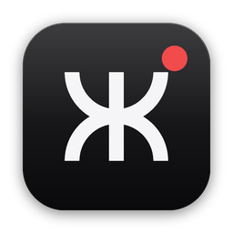
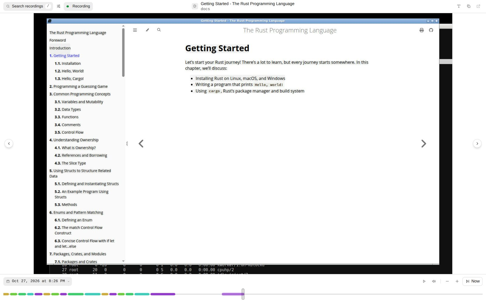
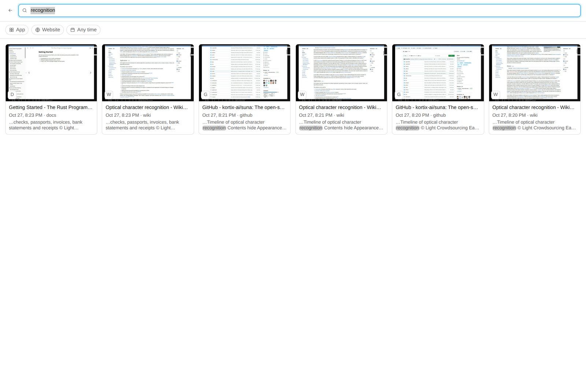
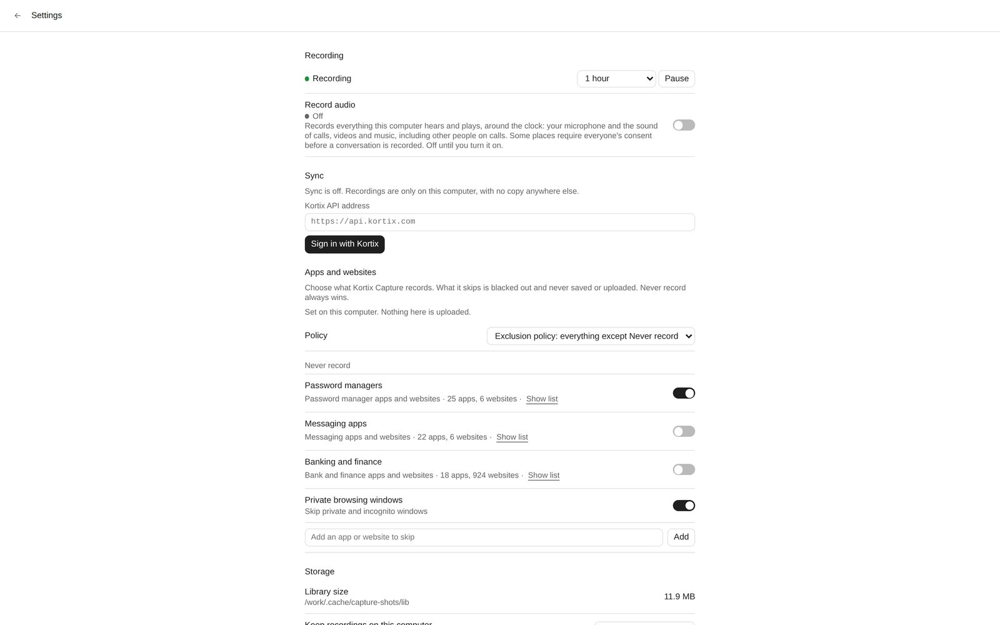

<p align="center">
  
</p>

<h1 align="center">Kortix Capture</h1>

<p align="center">
  <b>Everything on your screen, searchable by you and your agents.</b><br>
  A quiet, always-on recorder for Windows, macOS and Linux.
</p>

<p align="center">
  <a href="#install">Install</a> ·
  <a href="#company-install">Company install</a> ·
  <a href="#for-agents">For agents</a> ·
  <a href="#run-it-from-source">Run from source</a> ·
  <a href="#how-it-works">How it works</a>
</p>

<p align="center">
  <picture>
    <source media="(prefers-color-scheme: dark)" srcset="docs/screenshots/timeline-dark.jpg">
    
  </picture>
</p>

Kortix Capture takes a screenshot about every 2 seconds, reads the text on it
and keeps a searchable timeline on the computer. Scrub back to any moment,
search everything you have seen, or let an agent ask what you were doing.
Sync sends it to Kortix, to your own S3 bucket, or nowhere.

- **Always on.** Starts at login, restarts after a crash, survives sleep and lock.
- **Quiet.** No Dock icon, no taskbar button. The tray icon shows that it records.
- **Searchable.** Full-text search over screen text, apps, windows and URLs.
- **Agent-ready.** The `kortix-capture` CLI gives agents read-only access.
- **Private by default.** Password managers and private windows are never recorded.
- **Yours.** The library is SQLite and video on your disk. Sync is optional.

<table>
  <tr>
    <td width="50%">
      <picture>
        <source media="(prefers-color-scheme: dark)" srcset="docs/screenshots/search-dark.jpg">
        
      </picture>
      <p align="center"><b>Search</b>: every word that was on screen</p>
    </td>
    <td width="50%">
      <picture>
        <source media="(prefers-color-scheme: dark)" srcset="docs/screenshots/settings-dark.jpg">
        
      </picture>
      <p align="center"><b>Settings</b>: pause, sync, never record</p>
    </td>
  </tr>
</table>

<sub>Screenshots taken from a real Linux build recording a scripted desktop. See <a href="#run-it-from-source">Run it from source</a>.</sub>

## Install

| OS | Download | Installer |
|---|---|---|
| Windows | `https://<your Kortix>/download/capture/windows` | `KortixCapture-x64.msi` |
| macOS | `https://<your Kortix>/download/capture/macos` | `KortixCapture-universal.pkg` |
| Linux (X11) | `https://<your Kortix>/download/capture/linux` | `kortix-capture_amd64.deb` |

Recording starts at install. The first window asks you to sign in with
Kortix, which turns sync on. You can also pick your own S3 bucket, or keep
recordings on this computer.

To stop for a while, pause from the tray: 1 hour, until tomorrow, or until you
resume. Closing the window never stops recording.

## Company install

With an enrollment token, the install is silent. The computer records and
syncs from the first minute, with no window and no sign-in. Create the token in
Kortix under **Capture → Devices → Company install**.

```powershell
# Windows: as administrator, or through Intune / Group Policy
msiexec /i KortixCapture-x64.msi /qn KORTIX_URL=https://api.example.com ENROLLMENT_TOKEN=kortix_enr_...
```

```bash
# macOS: or deploy the .pkg with your MDM and a profile (installer/macos/examples)
echo '{"url":"https://api.example.com","enrollment_token":"kortix_enr_..."}' \
  | sudo tee "/Library/Application Support/Kortix/Capture/config.json" >/dev/null
sudo installer -pkg KortixCapture-universal.pkg -target /

# Linux (X11)
echo '{"url":"https://api.example.com","enrollment_token":"kortix_enr_..."}' \
  | sudo tee /etc/kortix/capture.json >/dev/null
sudo apt-get install ./kortix-capture_amd64.deb
```

On a company install the person cannot quit, sign out or turn sync off.
`kortix-capture machine status` shows the configuration (never the token), the
service and each session. The full IT guide is
[`/docs/capture/rollout`](../web/content/docs/capture/rollout.mdx).

<details>
<summary><b>Uninstall</b></summary>

| OS | Command |
|---|---|
| Windows | `msiexec /x KortixCapture-x64.msi /qn` |
| macOS | `sudo "/Applications/Kortix Capture.app/Contents/Resources/uninstall.sh"` |
| Linux | `sudo apt purge kortix-capture` |

Recordings stay on the computer until retention removes them.
</details>

## For agents

The CLI reads the library read-only, so it works while the recorder writes.
Add `--json` to any command.

```console
$ kortix-capture query fts recognition --limit 3
id  time                 app     title
88  2026-10-27T20:23:23  docs    Getting Started - The Rust Programming Language
87  2026-10-27T20:23:21  wiki    Optical character recognition - Wikipedia
85  2026-10-27T20:23:17  wiki    Optical character recognition - Wikipedia

$ kortix-capture usage top-applications --limit 3
name    time
docs    1m 10s
XTerm   1m 10s
hn      1m
```

| Command | What it gives |
|---|---|
| `now` | What is on screen, plus the last 10 minutes: a context bundle for an agent |
| `query fts <words>` | Full-text search: `AND`, `OR`, `NOT`, `"phrase"`, `prefix*` |
| `usage top-applications` / `top-domains` | Where the time went |
| `link at 20m` | A `kortix-capture://` link that reopens a moment in the timeline |
| `install-skill` | Installs the Kortix Capture skill for Claude Code, Codex, Cursor or OpenClaw |

Every query takes `--tr` (`2026-10-15`, `since:2026-10-01`, `2026-10-01|2026-10-31`).
Recorder control lives in the same binary: `status`, `pause`, `resume`,
`settings`, `exclude`, `storage`, `sync`, `ui`. See `kortix-capture --help`.

## Sync

Sync writes the **Kortix Capture bucket format (schema 2)** to S3-compatible
storage. It is the app's only contract with any cloud:
[spec](../../.agents/skills/kortix-capture/references/capture-format.md),
[JSON Schemas](schemas), [fixture bucket](fixtures/capture-format-v2).

| Destination | How |
|---|---|
| **Kortix** | Sign in (RFC 8628 device grant) or enroll. Kortix issues short-lived credentials scoped to the device's folder. Self-hosted Kortix works out of the box ([notes](../../.agents/skills/kortix-capture/references/self-host.md)). |
| **Your bucket** | Settings, or `kortix-capture sync setup --endpoint … --bucket …` with `KORTIX_CAPTURE_S3_ACCESS_KEY_ID` and `KORTIX_CAPTURE_S3_SECRET_ACCESS_KEY`. Add `--encrypt` for client-side AES-256-GCM. |
| **Off** | Everything stays on the computer. |

`sync status` shows the queue and the last error. `sync restore` rebuilds a
library from the bucket.

## Updates

The machine service updates the app in the background from each Kortix
release. It checks at start and every 6 hours, on the channel the build came
from (`stable` for `X.Y.Z`, `dev` for `X.Y.Z-dev.N`). It installs only an
Ed25519-signed manifest whose installer matches its size and SHA-256. A new
version that does not report healthy is rolled back and never tried again.

| IT setting | Windows (policy key) | macOS (`config.json` or profile) | Linux (`/etc/kortix/capture.json`) |
|---|---|---|---|
| Updates off | `AutoUpdate` = `0` | `auto_update`: `false` | `auto_update`: `false` |
| Pin the channel | `UpdateChannel` = `stable` / `dev` | `update_channel` | `update_channel` |

`kortix-capture --json machine status` shows `version` and `update`. The rules
are in the [release runbook](../../.agents/skills/kortix-capture/references/release-runbook.md#updater).

## Privacy

- Password managers and private browsing windows are skipped by default.
- What is skipped is blacked out and never saved or uploaded.
- Other exclusion lists and on-device personal-data masking sit behind the
  experimental **Privacy controls** switch: the organization's policy in
  Kortix, or Advanced → Experimental on a computer without one.
- With sync off, nothing leaves the computer except favicon lookups.
  `airgap: true` turns those off too.

## Run it from source

> [!WARNING]
> Never install or launch the packaged app on a development Mac. The
> installers register root services and ask for Screen Recording. CI installs
> it on real runners. From source, always use a scratch `KORTIX_CAPTURE_DIR`.

```bash
cd apps/capture

# Build
cargo build --release --features native-recorders \
  --bin kortix-capture --bin kortix-backend --bin kortix-capture-engine

# Record into a scratch library, then ask it what it saw
export KORTIX_CAPTURE_DIR=$(mktemp -d) KORTIX_CAPTURE_KEY_STORE=file
target/release/kortix-capture record          # Ctrl-C to stop
target/release/kortix-capture now
target/release/kortix-capture query fts "hello"

# Browse the timeline in a browser (dev only; the app never opens a port)
cargo build --release --example memory_ui_server
KORTIX_CAPTURE_ENGINE=target/release/kortix-capture-engine \
  target/release/examples/memory_ui_server "$KORTIX_CAPTURE_DIR" 8765
# → http://127.0.0.1:8765
```

<details>
<summary><b>Linux</b>: packages, and how the screenshots above were made</summary>

The release build adds `--features native-recorders,memory-ui,tray-linux`.
OCR uses `tesseract` and video uses `ffmpeg`.

```bash
sudo apt-get install -y build-essential pkg-config libxi-dev libxtst-dev libx11-dev \
  libxrandr-dev libxcb1-dev libxdo-dev libxss-dev libgtk-3-dev \
  libayatana-appindicator3-dev libwebkit2gtk-4.1-dev libsoup-3.0-dev \
  tesseract-ocr ffmpeg
```

Headless, it records an `Xvfb` display (X11 only; Wayland is not supported):

```bash
Xvfb :77 -screen 0 1600x1000x24 & openbox &
DISPLAY=:77 XDG_SESSION_TYPE=x11 target/release/kortix-capture record
```

The screenshots came from exactly that: a few browser windows and a terminal
on `Xvfb`, cycled with `xdotool`, then `memory_ui_server` and a headless
browser.
</details>

### Test

```bash
cargo test --features capture-engine
KORTIX_CAPTURE_TEST_VERSITYGW=/path/to/versitygw \
  cargo test --features capture-engine --test sync_s3    # sync against a real S3 gateway
pnpm --filter @kortix/capture test                       # the window's UI tests
```

A format change updates the schemas, the fixtures
(`KORTIX_CAPTURE_WRITE_FIXTURES=1 cargo test --test capture_format`), the API
reader (`apps/api/src/capture/format.ts`) and the CAP flows in one branch.
Every repeatable script is in [`scripts/README.md`](scripts/README.md).

## How it works

```text
tray ── supervises ──> kortix-capture record ──JSON lines──> kortix-capture-engine
 │                       │ capture loop (2 s)                 macOS: Swift (ScreenCaptureKit,
 │                       │ OCR (incremental)                    Vision, AX, HEVC)
 └─> timeline window     │ video chunks, retention, sync      Windows / Linux: Rust
                         v
           <library>/memory.db  frames/  videos/  audio/  actions/  settings.json

agents ──> kortix-capture now | query | usage | list | link      (read-only SQLite)
```

- The engine is the only platform-specific process. A request that times out
  kills it and the next one respawns it, so a wedged OS API never stalls
  recording.
- The library lives in `~/Library/Application Support/ai.kortix.capture`
  (macOS), `%APPDATA%\ai.kortix.capture` (Windows) or
  `~/.local/share/ai.kortix.capture` (Linux).

| Path | What it is |
|---|---|
| [`src/memory/`](src/memory) | Recorder, CLI, sync, privacy, storage, the company-install service, the updater |
| [`src/capture_engine/`](src/capture_engine) | Windows and Linux capture engine |
| [`native/macos/`](native/macos) | Swift macOS capture engine and its protocol |
| [`ui/`](ui) | Timeline, search and settings window |
| [`installer/`](installer) | `.msi`, `.pkg`, `.deb` and their services |
| [`schemas/`](schemas), [`fixtures/`](fixtures) | The bucket format contract |
| [`tests/`](tests), [`scripts/`](scripts) | Integration tests and verification scripts |

The Kortix side (devices, enrollment, policy, ingest, fleet health) is in
[`apps/api/src/capture`](../api/src/capture) and
[`apps/web/src/features/capture`](../web/src/features/capture). Product
behavior in full is in
[`app-behavior.md`](../../.agents/skills/kortix-capture/references/app-behavior.md).

## Release

Kortix Capture ships with every Kortix release, under the same version.

- [`capture-build.yml`](../../.github/workflows/capture-build.yml) builds,
  signs and verifies each installer on its own OS runner: silent install,
  onboarding, enrollment, uploads, always-on checks, upgrade in place and a
  clean uninstall.
- [`capture.yml`](../../.github/workflows/capture.yml) (manual) runs it for a
  branch and publishes the `capture-dev-latest` prerelease from `dev`.
- [`deploy-prod.yml`](../../.github/workflows/deploy-prod.yml) attaches the
  installers and `capture-update.json` to every `vX.Y.Z` release.

Secrets and human steps: the
[release runbook](../../.agents/skills/kortix-capture/references/release-runbook.md).

## License

Apache License 2.0, like the rest of this repository ([`LICENSE`](../../LICENSE)).
Third-party notices: [`THIRD_PARTY_NOTICES`](THIRD_PARTY_NOTICES).
