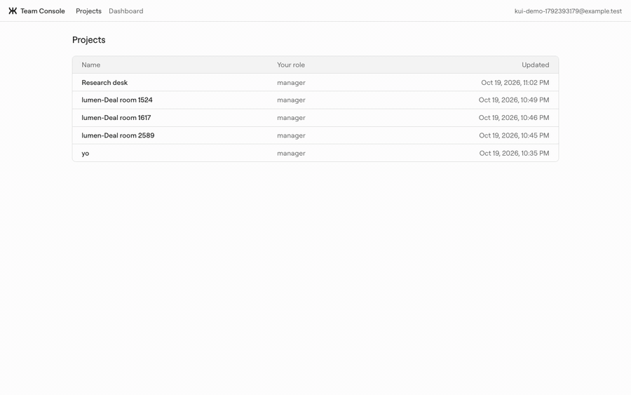
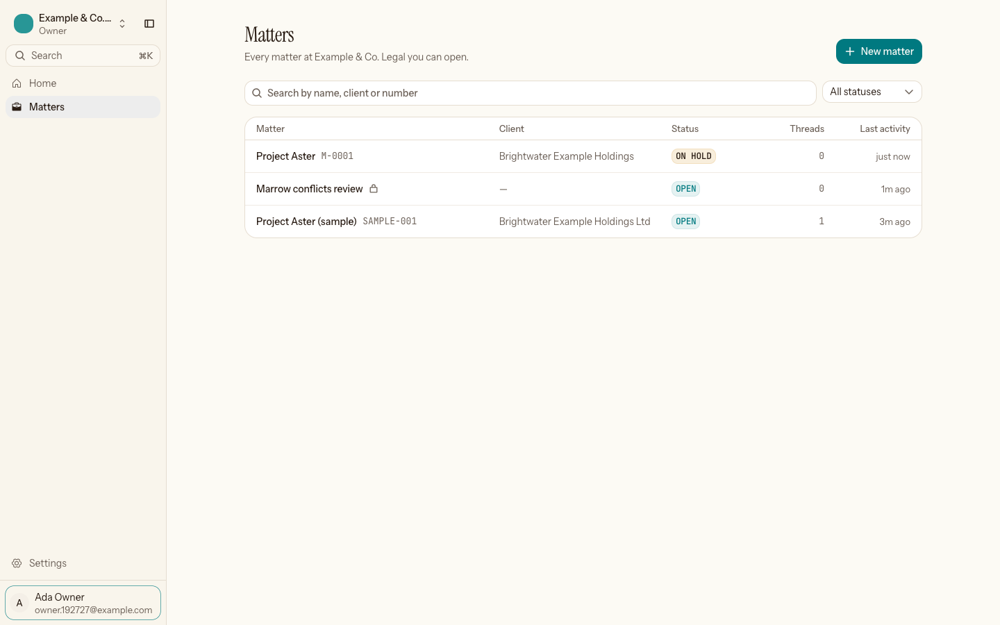

# White label on Kortix

Two reference apps. Both are thin consumers of [`@kortix/sdk`](../../packages/sdk/README.md)
and [`@kortix/ui`](../../packages/ui/README.md). Pick the one that matches who signs in.

| | [Team Console](team-console/README.md) (internal) | [Lumen](lumen/README.md) (customer SaaS) |
|---|---|---|
| Who signs in | People who already have Kortix accounts | The partner's own customers. They never see Kortix. |
| Identity | The Kortix App viewer identity (`kortixAppViewerToken`) | Lumen's own auth (Better Auth + organizations) |
| Data | Kortix is the data: projects, sessions | Lumen's own Convex database. Kortix ids are foreign keys on Lumen rows. |
| Hosting | `kortix apps deploy dist --type static --spa` | The partner's own hosting (Next.js + Convex) |
| Credential | Viewer token, inside the App | Server-held operator token. Members get a 1 h project-scoped token behind a same-origin proxy. |
| Billing | Kortix bills the account | The partner bills its customers (Stripe). Kortix bills the partner. |
| Pick it when | A team wants its own console over its own Kortix work | You sell a product with your brand, users, plans and data |

## Team Console

A Vite single-page app in four screens: projects, a project's sessions, a
session thread, and a cross-project dashboard. No backend, no login, no
database. It deploys as a static Kortix App.

<p align="center"></p>

## Lumen

AI for legal teams, sold by a partner to law firms. Lumen owns the customers,
accounts, firms, matters, plans, seats, audit log and data. Each firm maps to
one Kortix project; Kortix runs the agents, sandboxes and sessions behind it.

<p align="center"></p>

### Id mapping

```
Lumen (Convex)                     Kortix
───────────────                    ──────
firms.kortixProjectId      ──────▶ project      (provisioned with idempotency_key = lumen-firm-<firmId>)
matters.driveFolder        ──────▶ Drive folder /Company/Lumen/Matters/<matterId>/
threads.kortixSessionId    ──────▶ session      (labels lumen-firm:<id>, lumen-matter:<id>)
memberTokens               ──────▶ 1 h project-scoped token, held on Lumen's server
```

Lumen URLs carry only Convex ids. Kortix ids never reach a Lumen URL.

## Run locally

- Team Console: [team-console/README.md](team-console/README.md#try-it-now)
- Lumen: [lumen/README.md](lumen/README.md)

## Rules for both

1. Every Kortix call goes through `@kortix/sdk`. No raw `fetch` to the Kortix API.
2. One client per host (`createKortix`).
3. `scripts/sdk-boundary.mjs` in each app enforces 1 and 2. `pnpm --filter <pkg> typecheck` runs it.
4. Synthetic data only: fictional parties, `@example.com` emails, no customer documents.
