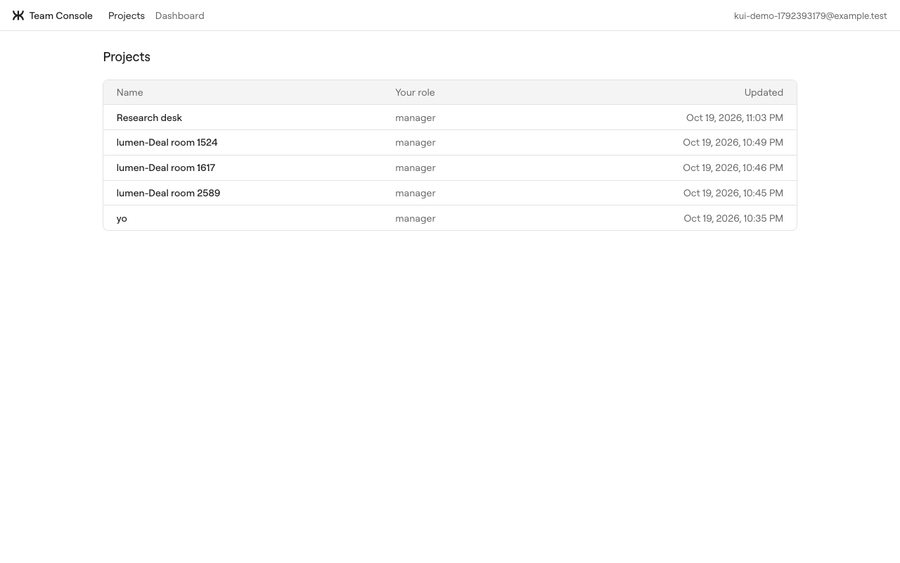
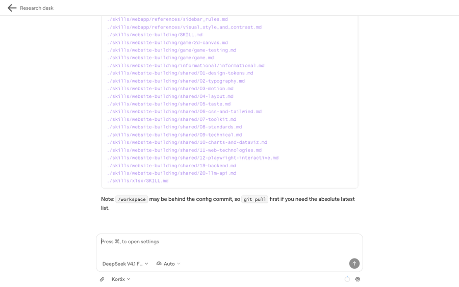
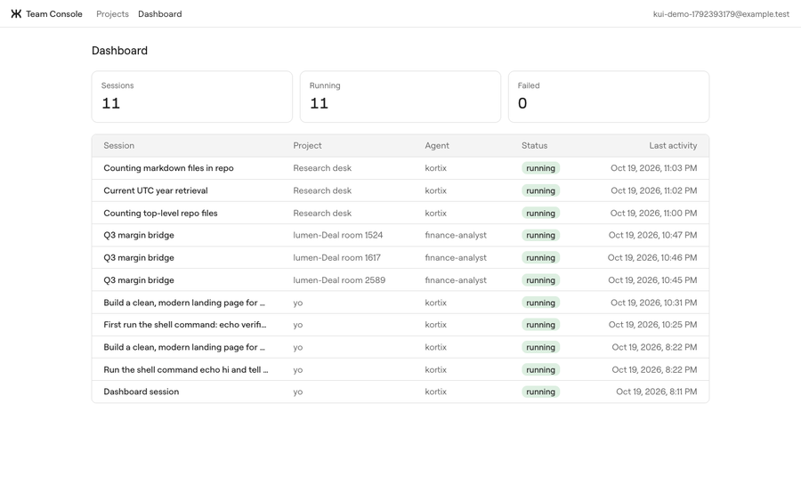

<div align="center">


# Team Console

**An internal tool on Kortix in four screens. No backend, no login, no database.**

Kortix is the identity and the data. Your team opens the App with their Kortix
login, and every call runs as them.

[Kortix Apps docs](https://kortix.com/docs/apps) · [SDK](../../../packages/sdk/README.md) · [@kortix/ui](../../../packages/ui/README.md) · [Lumen, the customer-facing example](../lumen/README.md)

</div>

## Try it now

| You have | Run |
|---|---|
| A Kortix project and the CLI | `pnpm --filter @kortix/white-label-team-console build`, then `kortix apps deploy apps/white-label/team-console/dist --slug team-console --type static --spa --access project` and `kortix apps access team-console --viewer api` |
| A Kortix API key, local dev | `KORTIX_API_URL=https://api.kortix.com/v1 KORTIX_API_KEY=<key> pnpm --filter @kortix/white-label-team-console dev`, then open `http://localhost:3032` |

<p align="center"></p>

## What it does

1. **Projects:** every project you can open in Kortix, with your role.
2. **Project:** its sessions, newest first, and **New session**.
3. **Session:** the same thread the Kortix web app renders (`SessionThread`
   from `@kortix/ui/session`): transcript, tool calls, approvals, the composer
   with model and agent pickers.
4. **Dashboard:** the view Kortix does not ship. Every session across every
   project, with status and last activity, in one table. It is about 80 lines
   over two SDK calls. This is the reason to build your own tool.

## When to pick this pattern

| | Team Console (this app) | [Lumen](../lumen/README.md) |
|---|---|---|
| Who uses it | Your own team. Everyone already has a Kortix login. | Your customers. They never see Kortix. |
| Identity | The Kortix login, through the Apps gate | Your own auth |
| Data | Kortix only | Your database, plus Kortix as the agent backend |
| Backend | None. A static App. | Yes: it holds the Kortix key and maps your users and ids to Kortix |
| Permissions | Each person's own Kortix role | Your app decides, then calls Kortix with a server credential |
| Brand | Kortix | Yours |

Pick this one when the people who use the tool are members of your Kortix
account. Pick Lumen when they are not.

<details>
<summary><b>Screenshots</b></summary>

<p align="center"></p>
<p align="center"></p>
<p align="center"></p>

</details>

## For developers

**Stack.** Vite, React 19, TypeScript, Tailwind 4. A Vite SPA builds to
`dist/`, which Kortix serves as a static App: no machine, no cold start.

**Auth is one line** (`src/kortix.ts`):

```ts
export const kortix = createKortix({ backendUrl: '/_kortix/api/v1', getToken: kortixAppViewerToken() });
```

The Apps gate on the App's origin answers `/_kortix/viewer` (who is looking,
plus a 1-hour token for the viewer) and forwards `/_kortix/api/v1/*` to the
Kortix API as that viewer. The browser makes no cross-origin call. The token
is capped by the viewer's own role. `--viewer api` turns the token on; without
it the app shows "Open this app from Kortix".

**Local dev uses the same code path.** `vite.config.ts` stands in for the
gate: it proxies `/_kortix/api/v1` to `KORTIX_API_URL` and sets
`Authorization: Bearer $KORTIX_API_KEY`. The key stays in the Vite process.
`/_kortix/viewer` answers a local viewer with a placeholder token. `vite
preview` gets the same stand-in, so you can test the built `dist/` locally.

**Files.**

| File | Holds |
|---|---|
| `src/kortix.ts` | The one `createKortix` client |
| `src/main.tsx` | Providers: React Query, `UiProvider`, icons, tooltips, toasts |
| `src/router.tsx` | A 4-route history router and the `@kortix/ui` navigation adapter |
| `src/app.tsx` | Shell, viewer gate, routes, shared cells |
| `src/pages/*.tsx` | Projects, project, session, dashboard |
| `scripts/sdk-boundary.mjs` | The boundary check |

**Boundary.** `pnpm --filter @kortix/white-label-team-console lint:sdk-boundary`
applies Lumen's rules (no OpenCode SDK, no runtime internals, no hand-built
runtime URLs, controls from `@kortix/ui`, no second UI kit, only one-segment
`@kortix/ui/<module>` entries, only the public `@kortix/sdk` entries) plus one
rule of its own: no `fetch` at all.

**Checks.**

```bash
pnpm --filter @kortix/white-label-team-console typecheck   # boundary + tsgo
pnpm --filter @kortix/white-label-team-console build       # boundary + tsgo + vite build
```

**Redeploy.** `pnpm --filter @kortix/white-label-team-console build && kortix apps deploy apps/white-label/team-console/dist --app team-console`.

**Limits.**

- A person with the `member` role needs an agent grant to start sessions on a
  project with agent permissions (`403 no_agent_access`).
- The dashboard reads the first 50 top-level sessions per project. Page with
  `sessions.listPage().next_cursor` for more.
- The main bundle is ~2 MB (585 kB gzip), almost all of it the session thread
  from `@kortix/ui/session`.
