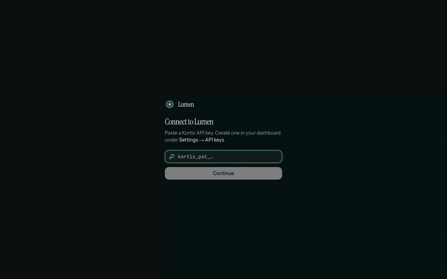
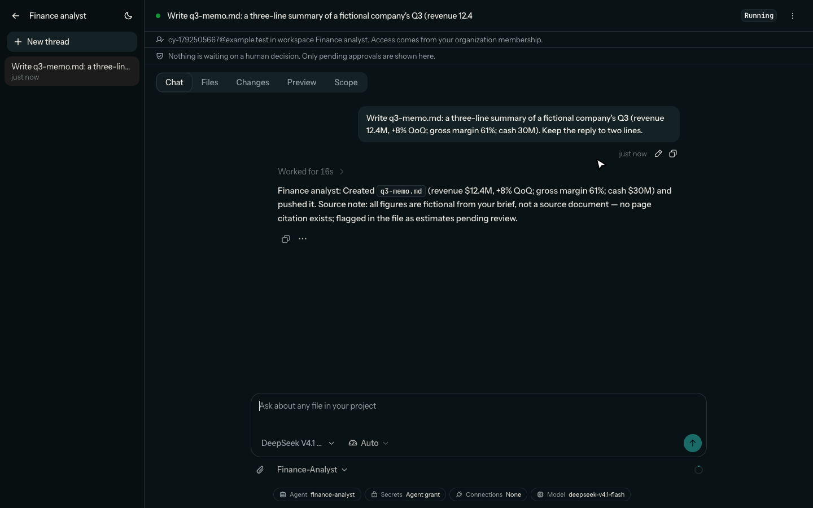
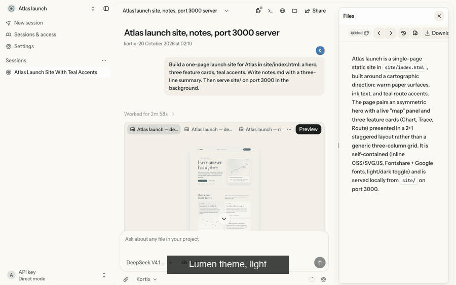
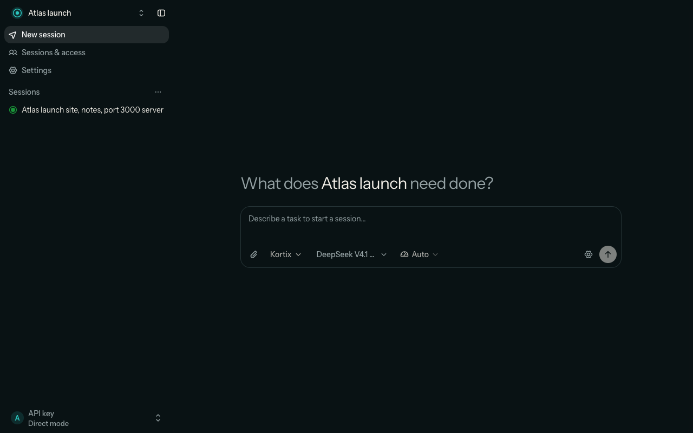
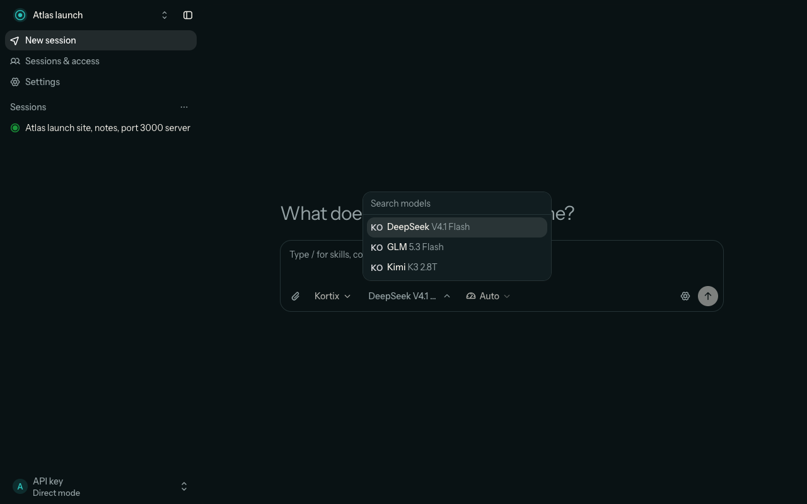
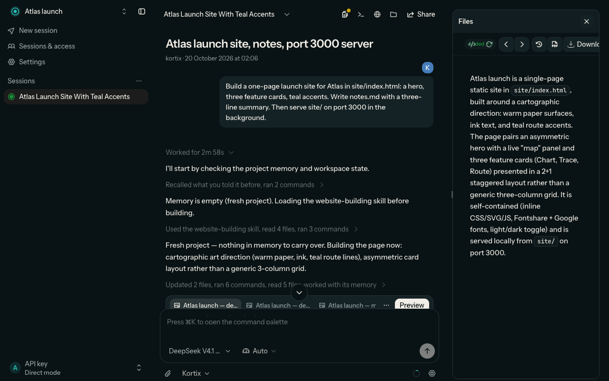
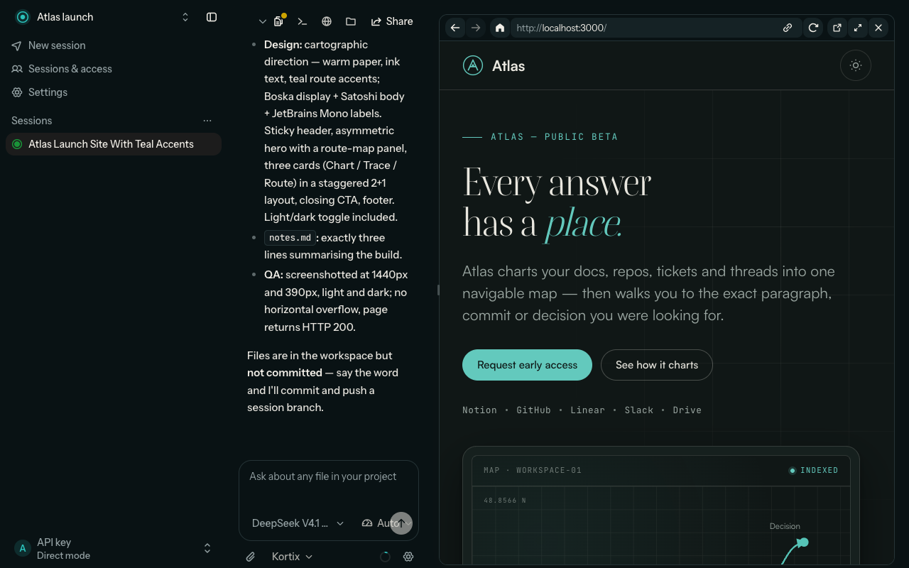
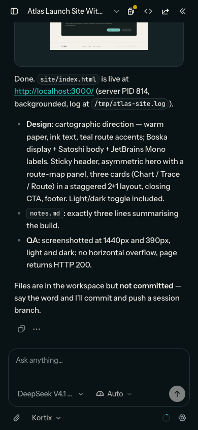

<p align="center">
  
</p>

<h1 align="center">Lumen</h1>

<p align="center">
  <b>Your agents, your repos, your brand.</b><br/>
  A complete white-label agent product, built on <code>@kortix/sdk</code> and <code>@kortix/ui</code> alone.
</p>

<p align="center">
  <a href="#try-it-now">Try it now</a> ·
  <a href="#what-it-does">What it does</a> ·
  <a href="#for-developers">For developers</a> ·
  <a href="https://kortix.com/docs/sdk/ui">@kortix/ui docs</a> ·
  <a href="https://kortix.com/docs/sdk">@kortix/sdk docs</a>
</p>

Lumen is the Kortix product experience in another company's brand. People sign in, pick a
project, describe a task, and watch an agent work in a cloud computer: the tool calls stream
in, the files it writes open in a side panel, and the app it serves runs in a live preview.
Every screen is a Kortix module from `@kortix/ui`. Every byte of data goes through
`@kortix/sdk`. The brand is one typed theme file. Fork it, change the name and the theme,
point it at a Kortix deployment, and it is your product.

## Try it now

| I want to… | Do this |
| --- | --- |
| **Run it against Kortix** | `NEXT_PUBLIC_KORTIX_API_URL=https://api.kortix.com/v1 pnpm --filter @kortix/whitelabel-demo dev`, open `http://localhost:3010`, paste a Kortix API key |
| **Run it against a local stack** | `pnpm worktree start <slug>`, then the command above with `NEXT_PUBLIC_KORTIX_API_URL=http://localhost:<api port>/v1` |
| **Keep the API key on the server** | Set `KORTIX_API_KEY` (wrapper mode): people sign in to Lumen, and Lumen calls Kortix for them. See [Deployment modes](#deployment-modes) |
| **Make it your brand** | Edit `src/config/brand.ts` (name, tagline) and `src/config/theme.ts` (colors, radius, fonts) |
| **Build your own on the same parts** | [kortix.com/docs/sdk/ui](https://kortix.com/docs/sdk/ui#build-a-dashboard) |



<details>
<summary><b>The session, still</b></summary>



</details>

## What it does

**Project home.** One composer to start a session: pick the agent, the model and the
thinking effort, attach files, press Enter. Lumen creates the session with the prompt and
opens it on the first frame.

**The session workspace.** The thread is Kortix's own: streaming markdown, grouped tool
rows, questions and approvals, the send error, Stop. Every file the agent touches is a
link. The header opens Files, the Terminal and the Browser in a resizable side panel, and
the composer keeps the model and agent pickers. Wrapper mode hides the Terminal: its proxy
is Next route handlers, which cannot upgrade the pty WebSocket.

**Files and the viewer.** The session's files, the changes it made, and a viewer for every
kind: markdown, code, pdf, docx, xlsx, csv, pptx, images.

**Live preview.** When the agent serves an app, it runs in the panel's browser on its port.
In wrapper mode Lumen resolves the preview URL on its server (`resolvePreviewUrl` →
`POST /api/preview-url`), with a project-scoped preview token. The Lumen session token
never appears in a frame URL.

**Sharing and access.** Kortix's share dialog: who can open a session, public links.
Members, roles and invites per account.

**Project settings.** Seven tabs: general (with the project's experiments), capabilities,
secrets, members, connectors, triggers, and the policies that gate tool calls.

**Session costs.** In wrapper mode, a per-session cost report with your markup applied.

**Your brand, not a recolor.** Lumen's theme changes the colors, the corner radius, the
density, the shadows, the motion curve and the type faces. Same components, same markup:



**Light, dark, system, and a phone.** The theme switch applies before the first paint. On
a phone the sidebar and the side panel are sheets.

<details>
<summary><b>More screenshots</b></summary>

| | |
| --- | --- |
|  |  |
|  |  |

<p align="center"></p>

</details>

## For developers

Lumen is the reference host for `@kortix/sdk` and `@kortix/ui`. It has no UI kit and no
transport of its own.

### Architecture rules

1. The browser creates one Kortix client, in `src/lib/kortix.ts`. Wrapper mode re-points
   that client; it never creates a second one.
2. One `useSession(projectId, sessionId)` hook owns each session: start, the sandbox, the
   live stream, the transcript, prompts.
3. Screens are `@kortix/ui` modules. Lumen's code is its chrome around them: the sidebar
   header and footer, the project switcher, the account pages, the approvals strip.
4. Server routes own privileged credentials and preview URL resolution.
5. Only the SDK sends requests to the Kortix backend.

### The session page

```tsx
// src/app/projects/[id]/sessions/[sessionId]/page.tsx (shortened)
import { useSession } from '@kortix/sdk/react';
import { SessionWorkspace } from '@kortix/ui/workspace';

function Workbench({ projectId, sessionId }: { projectId: string; sessionId: string }) {
  const session = useSession(projectId, sessionId);
  return <SessionWorkspace session={session} className="min-h-0 flex-1" />;
}
```

`SessionWorkspace` is the thread plus the resizable side panel. The project home is
`ProjectHome`, the sidebar list is `ProjectSessionList` and the share dialog is
`ShareSessionModal`, all from `@kortix/ui/workspace`. `src/components/project-shell.tsx`
and `src/components/project-sidebar.tsx` show how Lumen's chrome wraps them.

### The brand

- `src/config/brand.ts`: the product name, the tagline, the Kortix API URL.
- `src/config/theme.ts`: a typed `KortixTheme` (`@kortix/ui/theme`). `src/app/layout.tsx`
  compiles it with `themeToCss` into one `<style>` in `<head>`, so the first paint is on brand.
- `src/components/brand-mark.tsx`: the mark, passed to `UiProvider useBrand`, so the UI
  draws it wherever it would draw the Kortix symbol.
- Fonts come from `next/font` and feed `fonts.sans` / `fonts.mono`. A white-label never
  loads `@kortix/ui/fonts.css` (Roobert is for Kortix surfaces).

Never fork a component. Every key the theme takes: [kortix.com/docs/sdk/ui#theming](https://kortix.com/docs/sdk/ui#theming).

### Host adapters

`src/app/providers.tsx` mounts one `UiProvider`:

- `link={NextLink}` and `navigation` (the `next/navigation` hooks): links and router calls
  stay client-side.
- `config={{ managedModelsEnabled: true }}`: the model picker lists the deployment's models.
- `components={{ ShareSessionModal }}`: Kortix's share dialog. A slot left out hides its control.
- `IconProvider` (`@kortix/ui/icon-provider`) and one `<Toaster />` (`@kortix/ui/toast`).

### Client boundary

`scripts/sdk-boundary.mjs` runs before `build`, `test`, `test:e2e` and `typecheck`. It
rejects, in client code:

- an import of the OpenCode SDK or of an SDK transport module (only `@kortix/sdk` and
  `@kortix/sdk/react`);
- a constructed runtime proxy path, OpenCode REST path, or `previewUrl()` / `proxyUrl()` call;
- a legacy runtime store;
- a raw request to the Kortix backend, or to a BFF route outside the allowlist;
- a local UI kit: a file under `src/components/ui`, `lucide-react`, `radix-ui`,
  `class-variance-authority`, `next-themes`, `react-markdown`, a direct sonner `toast` call,
  or the `@kortix/ui/dialog` primitive.

### Deployment modes

`GET /api/mode` selects the mode at process start.

**Direct mode** (default). The person pastes a Kortix API key. The browser keeps it in
`localStorage`, and the SDK client calls `NEXT_PUBLIC_KORTIX_API_URL` directly. The
browser origin must be in that API's CORS list (a local stack allows `:3000` and `:3010`).

**Wrapper mode** (`KORTIX_API_KEY` set). People sign in to Lumen through `/api/auth/*`.
The SDK client calls `/api/kortix`, and the BFF forwards through `@kortix/sdk/server`,
which substitutes `KORTIX_API_KEY` upstream. The key never reaches the browser.

- `src/server/users.ts`: per-user project ownership.
- `src/server/policy.ts`: a deny-by-default route policy.
- `src/server/rate-limit.ts`: per-user limits (`RATE_LIMIT_PER_MIN`).
- `/api/session-costs`: session costs with `COST_MARKUP` applied.

```bash
KORTIX_API_KEY=kortix_pat_example \
KORTIX_UPSTREAM=https://api.kortix.com/v1 \
SESSION_SECRET=replace-with-a-long-random-value \
pnpm --filter @kortix/whitelabel-demo dev
```

Known limit: in wrapper mode the session preview frame loads Lumen's own sign-in page,
because the preview host resolves to Lumen's server. Direct mode previews work.

### Server-first preview

The side panel reads the preview candidates through the session's SDK handle and posts the
port to `POST /api/preview-url`. The route authenticates the caller, checks ownership in
wrapper mode, makes a request-scoped SDK client, calls `session.ensureReady()`, resolves the
preview URL and mints a project-scoped preview token. It returns one final URL: no token,
upstream base URL or runtime coordinates reach the browser.

### Routes

| Route | Surface |
| --- | --- |
| `/` | Project list, new project, import |
| `/account` | Accounts, members, roles, invites, account projects |
| `/projects/[id]` | Project home (`ProjectHome`) |
| `/projects/[id]/sessions` | Sessions and access |
| `/projects/[id]/sessions/[sessionId]` | The session workspace (`SessionWorkspace`) and pending approvals |
| `/projects/[id]/settings` | General (with experiments), capabilities, secrets, members, connectors, triggers, policies |
| `/session-costs` | Wrapper-mode session costs with markup |

### Run and verify

```bash
pnpm install
WHITELABEL_PORT=3010 NEXT_PUBLIC_KORTIX_API_URL=http://localhost:<api port>/v1 \
  pnpm --filter @kortix/whitelabel-demo dev
```

A second dev server in the same folder needs its own build folder:
`NEXT_DIST_DIR=.next-2 WHITELABEL_PORT=3000 pnpm --filter @kortix/whitelabel-demo dev`.
Start the local stack with its tunnel (no `--no-tunnel`): a cloud sandbox calls back to the
local API through it, and without it no session starts.

```bash
pnpm --filter @kortix/whitelabel-demo typecheck
pnpm --filter @kortix/whitelabel-demo build
pnpm --filter @kortix/whitelabel-demo lint:sdk-boundary
```

The e2e suite (`tests/e2e`) boots the production server and verifies auth, mode selection,
ownership, route policy, proxy behavior, preview resolution, rate limits, cost markup and
the SDK boundary. Run one file at a time on a laptop: `bun test tests/e2e/<file>`.

The screenshots and GIFs in `public/screenshots/` were recorded against a real cloud
session on a local stack, with synthetic data.
