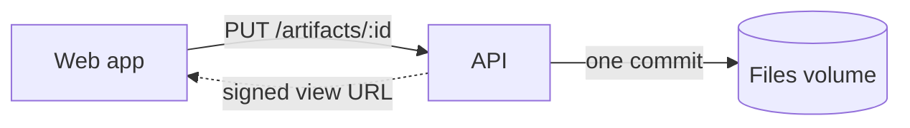

# Diagrams in artifacts

A diagram earns its place when it lets a cold reader see a mechanism they would
otherwise assemble from prose:
- where data flows;
- which components talk;
- what changes between two options;
- what states a request moves through.

If a sentence says it faster, write the sentence.

## What to draw

- **The mechanism, not its name.** A box labeled "cache" says less than the
  prose. Draw the path a request takes through it, the two stores it sits
  between, and the arrow that disappears without it. Show the parts the
  argument hinges on (the boundary crossed, the hop added, the data that
  moves) and leave out the rest.
- **Comparing options? Draw the difference.** Draw two architectures side by
  side, or a before and an after. Mark the one edge each option adds or
  removes. The reader must be able to point at what they choose between. A
  separate box per option, connected to nothing, is a restated list.
- **Match complexity to the stakes.** A one-hop question is a three-box
  diagram. A migration that reroutes writes through a queue needs the queue,
  the writer, the reader and the ordering arrow. Draw only what the decision
  turns on.
- **Label the arrows.** An unlabeled arrow means "related somehow". A label
  such as `writes`, `invalidates` or `polls every 30 s` is information. Add a
  legend only when one encoding (dashed, colored) repeats.

## In a doc: mermaid

A ` ```mermaid ` fence renders as a diagram in the viewer, the editor and the
PDF.



- Prefer `flowchart LR` for flows, `sequenceDiagram` for who calls whom in
  order, and `stateDiagram-v2` for lifecycles.
- Keep node labels to a word or three, and quote a label that holds
  punctuation.
- Put the claim in the sentence above or below the fence, not in the diagram.

## In a page: inline SVG

Hand-author `<svg>` with native shapes (`rect`, `circle`, `line`, `path`) and
`<text>`: no library, no external image. A page may instead load mermaid from a
pinned CDN version, when a flowchart is enough.

- **Size by `viewBox`.** Set `viewBox="0 0 W H"` and
  `style="max-width:100%;height:auto"`. Choose W and H for the content. Flows
  read left to right; stacks read top to bottom.
- **Theme with `currentColor`.** Strokes, text and arrowheads in
  `currentColor` follow the page in light and dark. Give one literal hue only
  to the element that carries the point, and check that it reads on both
  backgrounds.
- **Arrowheads:** a `<defs><marker id="arrow">` referenced by
  `marker-end="url(#arrow)"`, or a small `<polygon>`.
- **Legible text:** about 11–13 px at the drawn scale, set with
  `text-anchor`, with short labels. Sentences go in the caption.
- **Align to a grid:** shared baselines and even gaps.
- **One figure, one claim.** Wrap it in `<figure>` with a `<figcaption>` that
  states what it shows. Give the `<svg>` `role="img"` and an `aria-label` with
  the same claim.
- **Self-contained:** no `<script>`, `<style>` or `<foreignObject>` inside the
  SVG. Long decorative path data means the drawing wants Canvas instead.
