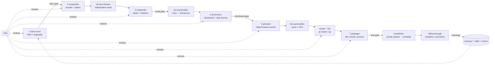

# Architecture

## The loop

- **Agents do creative work; `yt` does exact work.** State, validation, timing, rendering, mixing,
  QA, storage and upload are deterministic code with tests. Agents can't "forget" a step: the state
  machine refuses to advance without valid outputs.
- **Narration-first timing.** Voice is generated right after the script gate; scene lengths derive
  from beat timings; scenes reference *cue words* (`Kit.cue`) not seconds, so a re-voice is a
  `yt scene retime` away from in-sync again.
- **Scenes are standalone HyperFrames projects**, rendered and cached independently (content hash),
  concatenated losslessly. A one-scene fix re-renders one scene.
- **Audio is mixed in ffmpeg**: beats placed on the timeline, music side-chain ducked under the voice,
  SFX on cue words, two-pass loudnorm to −14 LUFS.
- **Quality loop**: maker → `yt` checks → critic (rubric, vision on contact sheets) → revise (≤3) →
  human gate. Human rejections feed the harness-reflector, which proposes skill/rubric changes.
- **Harness**: sessions run on **pi** (`runtime: pi`). Stage agents are pi subagents dispatched with
  `task`; they can't nest or ask the user, so the showrunner owns critic dispatch and human questions.
- **Persistence**: episode text artifacts on branch `episode/<slug>`; media in S3/R2 indexed by
  `media.lock.json`; any fresh sandbox can resume from `episode.yaml`.

## Gates
`channel.yaml → gates` sets each of `topic`, `script`, `storyboard`, `final` to `human`, `critic` or
`auto`. Milestone 1 runs all four as `human`. Moving a gate to `critic` is how the loop becomes more
autonomous, one gate at a time, once the critic's judgement has matched human verdicts for a few
episodes. Upload/schedule are hard-wired to require a human-approved final gate.

## Verified in this repo (offline, 2026-10-13)
- `bun test` — 36 unit tests (schemas, state machine, gates, lint, fact-check merge, alignment,
  timing, scene windows, captions, chapters, description, b-roll caps, ffmpeg mix/loudness).
- `yt smoke` — full offline episode through the real state machine: stub voice/music/SFX, three
  kit-built scenes through `hyperframes check` + snapshots, cached renders, ffmpeg concat + mix,
  final QA (1080p30, duration = timing ±0, −14.0 LUFS, no black frames/dead air), sources page,
  description, code-rendered thumbnail. ~2 min on 4 vCPU.
- `kortix validate` — manifest, agent files, skills, Dockerfile lint.
- HyperFrames render speed: 10 s 1080p30 in ~26 s on 4 vCPU (software GPU).

## To verify on Kortix Cloud (phase-0 spikes, need the project + keys)
| # | check | how | fallback if it fails |
|---|---|---|---|
| 1 | `Dockerfile.video` builds; Chrome works in the sandbox | `kortix sandboxes build --local video`, then a session runs `bin/yt smoke` | use platform image + `npx hyperframes browser ensure` at session start |
| 2 | Render time on the 6-vCPU `video` sandbox for a 60 s scene | `bin/yt render` on a pilot act | raise template CPU; render acts in child sessions; HyperFrames Lambda/Cloud Run |
| 3 | Episode branch persistence across sessions | showrunner pushes `episode/<slug>`, next tick restores it | keep one keyed session per episode; merge state to main per stage via CR |
| 4 | `kortix review submit/show --json` shapes | `bin/yt gate request --submit`, then `bin/yt gate sync` | gate via `bin/yt gate approve/reject` from the person's chat |
| 5 | ElevenLabs v3/v4 `with-timestamps` alignment (verified on v4, Oct 2026) | `bin/yt voice` on the pilot | alignment fallback: `hyperframes transcribe` (whisper) |
| 6 | ElevenLabs Music endpoint/params (`/v1/music`) | `bin/yt sound` | stock/licensed music file dropped into `media/music/` |
| 7 | YouTube private upload + captions + `containsSyntheticMedia` | `bin/yt youtube upload` on the pilot | upload manually; keep metadata flow |
| 8 | fal.ai model id (only when b-roll is enabled) | `bin/yt broll gen` | keep b-roll off |

## Throughput & cost (estimates for a 6–8 min episode)
- Wall-clock: research + fact-check 1–2 h, script 0.5–1 h, voice minutes, storyboard 1 h, scenes
  4–10 h of agent time (parallelisable per act), render ~20 min, packaging 0.5 h. Plus human gate
  latency. Realistic cadence: 1 episode/week with 4 short human reviews.
- Media APIs: TTS ~$1–3, music ~$5, SFX ~$1–2 (tracked in `yt cost`). Model spend dominates and is
  tracked by Kortix billing — expect it to be the main cost; measure it on the pilot.

## Roadmap after milestone 1
1. Pilot episode on Kortix Cloud; calibrate rubrics against the human gate verdicts.
2. Manim adapter for maths-heavy scenes (render to MP4, mount as a scene asset).
3. Three.js / Blender (CPU) scene types for 3D and claymation shots.
4. Generative b-roll on, capped, for atmosphere shots (fal.ai), with the disclosure flag logic.
5. Thumbnail/title A/B testing (YouTube "Test & compare") fed into `memory/packaging.md`.
6. Promote gates from `human` → `critic` one at a time as agreement is demonstrated.
7. Personalised variants: same claims + storyboard, re-voiced and re-paced for a level/language;
   the deterministic pipeline makes per-viewer renders a re-run, not a re-production.
